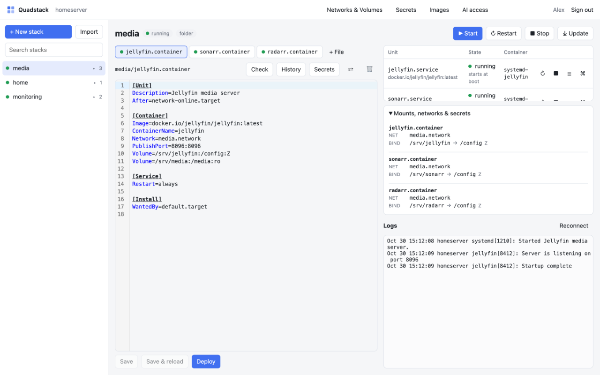

# Quadstack

A small web UI for **rootless Podman Quadlets**, in the spirit of [Dockge](https://github.com/louislam/dockge): your `.container`, `.pod`, `.network` and other Quadlet files grouped into stacks you can edit, check, start, stop and update from the browser, with live logs and container shells.

Quadstack runs as a user service of the account that owns the Quadlets, with no root helper. It manages Quadlet services through systemd's D-Bus API and uses Podman's native REST API over that account's local rootless Unix socket for container information, image pulls, pruning, secrets and container shells. It does not invoke the Podman CLI or expose the Podman API over TCP. Quadlet configuration stays in `~/.config/containers/systemd`.



*Stack editor with sample data.*

- **Stacks.**
  - Each folder in the Quadlet directory is a stack.
  - At the top level, a `.pod` forms a stack together with the containers that set `Pod=` to it. Every other unit is a stack of its own.
  - Drop-ins (`name.container.d/*.conf`) and `.env` files are listed with their stack.
  - Symlinked files and folders are not managed: Quadstack lists them in a warning and never writes through them. Their units still run, because quadlet follows links.
- **Editor.** CodeMirror, with completion of Quadlet keys and sections.
  - **Check** runs Podman's own generator (`quadlet -dryrun -user`) on a scratch copy of the whole directory, so references between files resolve. A file Podman rejects is not saved unless you insist.
  - **Show generated unit** shows the systemd service Quadlet will produce.
  - **Save & reload** runs `daemon-reload`. **Deploy** also restarts the unit.
- **History, without git.** Every save, move or delete first keeps the previous version under `~/.local/state/quadstack/history`, for the last 50 versions per file. A moved file takes its history along. You can diff any version against the editor and load it back. Deleted files are listed on the start page, where you can restore them. **Forget** drops a file's saved versions for good, for example old credentials in an `.env` file.
- **Units.** Start, stop or restart a whole stack or a single unit. You see their systemd state and whether they start at boot (`[Install]`).
- **Activity.** Managed actions are queued on the server, with per-step progress, elapsed time, deadlines, results, errors and links to logs. Navigating away or reloading the page does not cancel a web action. Connection loss and timeouts are reported explicitly, not as success; unavailable unit state is shown as unknown rather than stopped.
- **Logs.** A live `journalctl` view per stack or per unit.
- **Update.** Pulls the images of a stack's containers with live API progress in Activity and offers a restart afterwards.
- **Shell.** Opens a container exec session through Podman's API in the browser. You can turn it off with `QUADSTACK_TERMINAL=false`.
- **Networks & volumes.** Top-level `.network` and `.volume` files are shared resources rather than stacks, listed with the stacks that use them, next to the Podman networks and volumes no file defines. Each stack shows its containers' bind mounts, volumes, networks and secrets.
- **Secrets.** Podman secrets: create, replace and delete, with the files that use each one. Values go only in the local API request body, never in a command line or Activity, and are never returned. In a container's editor, **Secrets** moves an `Environment=` value or a mounted key file into a secret and rewrites the line to `Secret=`.
- **Images.** A list with sizes and usage, plus pruning of dangling or unused images.
- **Import.** Paste a `docker run` command or a compose file and get Quadlet files. This needs [podlet](https://github.com/containers/podlet) on `PATH`. The installer offers to install it to `/usr/local/bin` and keeps it up to date on updates. Unattended runs skip it unless `QS_PODLET=1` is set.
- **AI access over MCP, off by default.** See [AI access](#ai-access-mcp).
- **Sign-in with OpenID Connect only** (Pocket ID, Authentik, Keycloak, …). Access is limited to the listed users and/or groups. Quadstack refuses to start without such a list.

## Requirements

- Linux with systemd and Podman 4.4 or newer. Podman 5 is recommended.
- A user account that owns the Quadlets, with lingering enabled (`loginctl enable-linger <user>`).
- That user's `podman.socket`, enabled by the installer or manually with `systemctl --user enable --now podman.socket`.
- An OIDC client whose redirect URI is `https://<your host>/auth/callback`.
- A reverse proxy with TLS in front of Quadstack.

## Action feedback and recovery

Activity keeps the 50 most recent operations in memory. Web actions continue on the server after navigation, page reloads, or a dropped browser connection; restarting Quadstack clears this history. Operations run one at a time to avoid replacing each other's systemd jobs. The queue accepts at most 16 pending operations. A normal operation has a five-minute deadline, including queue time; image-pull operations have fifteen minutes. Individual API and D-Bus calls also have deadlines.

A container that shares another container's network (`Network=container:<name>` or `Network=<file>.container`, typically behind a VPN container) loses that network when the other container stops or restarts. So an action on the other container includes it: it is stopped first, and after a restart started again, each as its own step. Containers that were not running stay stopped. See [Containers behind a VPN container](#containers-behind-a-vpn-container).

Each step reports queued, running, succeeded, failed, timed out, cancelled, unknown, or skipped. Deploy does not restart a unit if daemon-reload fails, and deletion does not remove a file if its requested stop fails. A successful systemd job means systemd completed that job, not that the application passed a health check. A timeout or lost connection does not prove that an already-submitted job or exec command stopped. Inspect its state and logs before retrying; Quadstack never automatically retries a mutating request.

The web action endpoints return an operation ID immediately instead of holding a request open while systemd or an image pull finishes. `GET /api/operations` and `GET /api/operations/{id}` return progress and results for signed-in users. Saving a file returns its validation and, when requested, a separate apply operation, so a successful save is not confused with a successful deployment.

## Install

Run the installer as root. It works on a Proxmox VE host and on an existing machine:

```sh
bash -c "$(curl -fsSL https://raw.githubusercontent.com/denMaier/quadstack/main/deploy/install.sh)"
```

It does different things depending on where it runs:

- **On a Proxmox VE host**, it creates a new LXC. It uses the [community-scripts](https://github.com/community-scripts/core) engine, pinned to a tested commit, with its usual dialogs for resources, storage and network. The container is a Debian 13 LXC, unprivileged and with nesting and keyctl enabled, which rootless Podman needs. Inside it, the installer sets up Podman and an account `quadlets` that owns the Quadlets. Later, `update` in the container offers **update** or **reconfigure**.
- **Anywhere else** (an existing LXC, VM or server with systemd), it installs Quadstack on that machine as an add-on. It lists the accounts that already have a Quadlet directory and lets you choose one or create a new one. Podman is installed with apt if it's missing. Running it again offers **update** or **reconfigure**. Reconfigure changes the settings and restarts Quadstack; the installed version stays.

It asks for:

- the public URL;
- the OIDC issuer, client ID and secret;
- the groups and/or users allowed to sign in;
- the listen address and port (default `0.0.0.0:8090`, all IPv4 interfaces);
- whether to allow shells into containers;
- the longest an MCP grant may last.

Choose another port with an address such as `0.0.0.0:9080`, or bind to `127.0.0.1:9080` when the reverse proxy runs on the same machine. On an existing installation, choose **reconfigure** to change the address or port; **update** preserves it. Unattended installs can set `QS_LISTEN` to the full address and port.

It shows the redirect URI to register with your provider before asking for the client. An answer it can't use is asked again, with what you typed filled in. A URL without a scheme gets `https://`. It also sets `XDG_RUNTIME_DIR` in the account's shell profile, so `systemctl --user` works after `sudo -iu <user>` or `su <user>`. The binary is checked against the release's `SHA256SUMS`. When the account is a system account, the installer offers the journal ACL from [Logs of system accounts](#logs-of-system-accounts).

For an unattended run, answer the questions in the environment and set `QS_YES=1` (see the top of [`deploy/install.sh`](deploy/install.sh)):

```sh
QS_YES=1 QS_USER=quadlets QS_PUBLIC_URL=https://quadstack.example.com \
QS_ISSUER=https://id.example.com QS_CLIENT_ID=quadstack QS_CLIENT_SECRET=… QS_ALLOWED_GROUPS=admins \
  bash -c "$(curl -fsSL https://raw.githubusercontent.com/denMaier/quadstack/main/deploy/install.sh)"
```

In an unprivileged LXC, the account's subordinate IDs have to fit in the container's 65536 IDs. A new account therefore gets the IDs above its own UID, which leaves containers about 64,500 UIDs instead of 65,536. Images with files owned by higher IDs, such as `nobody` (65534), fail to pull there. Give the LXC a larger ID map if you need those.

### Manual install

As the account that owns the Quadlets:

```sh
mkdir -p ~/.local/bin ~/.config/quadstack ~/.config/systemd/user
curl -L -o ~/.local/bin/quadstack \
  https://github.com/denMaier/quadstack/releases/latest/download/quadstack_linux_amd64
chmod +x ~/.local/bin/quadstack

curl -L -o ~/.config/quadstack/quadstack.env \
  https://raw.githubusercontent.com/denMaier/quadstack/main/deploy/quadstack.env.example
chmod 600 ~/.config/quadstack/quadstack.env
$EDITOR ~/.config/quadstack/quadstack.env

curl -L -o ~/.config/systemd/user/quadstack.service \
  https://raw.githubusercontent.com/denMaier/quadstack/main/deploy/quadstack.service
systemctl --user daemon-reload
systemctl --user enable --now podman.socket
systemctl --user enable --now quadstack
```

Use `quadstack_linux_arm64` on ARM. `SHA256SUMS` only shows that a download is complete, as it comes from the same place as the binary. To check that GitHub Actions built the binary from this repository, use the GitHub CLI:

```sh
gh attestation verify ~/.local/bin/quadstack --repo denMaier/quadstack
```

For a system account without a login shell, run these with `sudo -iu <user>`. If `systemctl --user` can't find the bus, use `sudo machinectl shell <user>@`.

### Logs of system accounts

journald gives only accounts with UID 1000 or higher their own journal. When the Quadlets belong to a system account (UID below 1000, as created by `useradd --system` or by some managers), its logs land in the system journal, which it may not read, and Quadstack shows a warning instead of logs. Grant the account read access with ACLs, as root (replace `quadlets` with the account name):

```sh
printf '%s\n' \
  'a+ /var/log/journal    - - - - d:user:quadlets:r-x,user:quadlets:r-x' \
  'A+ /var/log/journal/%m - - - - d:user:quadlets:r-x,user:quadlets:r-x' \
  > /etc/tmpfiles.d/quadstack-journal.conf
systemd-tmpfiles --create /etc/tmpfiles.d/quadstack-journal.conf
```

This lets the account, and so anyone who can sign in to Quadstack, read the whole system journal. Adding the account to the `systemd-journal` group does the same, but only takes effect after its systemd user instance, and with it every container, restarts.

### Update

Run the installer again and choose **update**, or do the same with `update` in an LXC it created. Update installs the binary and the managed `quadstack.service` from the same published release, reloads systemd, enables and starts the rootless Podman socket, and restarts Quadstack. Pushing source to `main` alone does not publish a release or update running hosts.

Settings, Quadlets, history and systemd drop-ins stay. The main `quadstack.service` file is replaced; keep service customizations in `~/.config/systemd/user/quadstack.service.d/*.conf` instead of editing that file.

For an unattended update, run as root:

```sh
QS_MODE=update QS_YES=1 \
  bash -c "$(curl -fsSL https://raw.githubusercontent.com/denMaier/quadstack/main/deploy/install.sh)"
```

For a manual upgrade, replace both the binary and `~/.config/systemd/user/quadstack.service` with the files from the same release, then run as the account that owns the Quadlets:

```sh
systemctl --user daemon-reload
systemctl --user enable --now podman.socket
systemctl --user restart quadstack
~/.local/bin/quadstack -version
```

## Configuration

Every setting is an environment variable. See [`deploy/quadstack.env.example`](deploy/quadstack.env.example).

| Variable | Default | |
| --- | --- | --- |
| `QUADSTACK_LISTEN` | `127.0.0.1:8090` | Address and port; the installer defaults to `0.0.0.0:8090` |
| `QUADSTACK_PUBLIC_URL` | *required* | The URL people open, used for the OIDC callback |
| `QUADSTACK_OIDC_ISSUER`, `_CLIENT_ID`, `_CLIENT_SECRET` | *required* (secret optional for public clients) | |
| `QUADSTACK_OIDC_SCOPES` | `openid profile email groups` | |
| `QUADSTACK_OIDC_GROUPS_CLAIM` | `groups` | Read from the ID token, or from userinfo when the ID token has none |
| `QUADSTACK_ALLOWED_USERS` | | `sub`, verified `email` or `preferred_username` values, comma separated. Values containing `@` are matched as a subject or verified email, not as a username. |
| `QUADSTACK_ALLOWED_GROUPS` | | Groups that may sign in |
| `QUADSTACK_QUADLET_DIR` | `~/.config/containers/systemd` | |
| `QUADSTACK_STATE_DIR` | `~/.local/state/quadstack` | History and the session key |
| `QUADSTACK_QUADLET_BIN` | found in `/usr/libexec/podman` or `/usr/lib/podman` | Validation is skipped when it is missing |
| `QUADSTACK_PODLET_BIN` | `podlet` on `PATH` | Enables Import |
| `QUADSTACK_PODMAN_SOCKET` | `$XDG_RUNTIME_DIR/podman/podman.sock`, otherwise `/run/user/<uid>/podman/podman.sock` | Absolute local Unix socket path; TCP URLs are rejected |
| `QUADSTACK_TERMINAL` | `true` | Shells into containers, and the MCP `exec` tool |
| `QUADSTACK_MCP_MAX_HOURS` | `24` | The longest an MCP grant may last; `0` turns MCP access off |

## AI access (MCP)

Quadstack has an [MCP](https://modelcontextprotocol.io) endpoint at `<QUADSTACK_PUBLIC_URL>/mcp` for AI assistants such as Claude Code. It refuses every request until you create a **grant** under **AI access**. A grant has:

- **An end.** It lasts from 15 minutes up to `QUADSTACK_MCP_MAX_HOURS` (24 by default), and **End now** stops it at once. An edit can move the end, but never past that maximum from now.
- **Its own bearer token.** The token is shown once. Quadstack stores only its SHA-256 hash.
  - The token outlives the grant's end: **Reactivate** an ended grant and the same client is let back in for the time you choose. So each machine is set up once.
  - **Delete** removes the grant and its token for good, for example when you suspect the token was copied.
- **Rules.** A table of permissions by stack, plus some account-wide permissions. You can start from a preset (Nothing, Read only, Read & operate, Everything) and then change single boxes. Clicking a column or row name switches the whole line.

### Connecting a client

After **Create grant**, the page shows the token with a ready command for Claude Code:

```sh
claude mcp add --scope user --transport http quadstack-<host> https://quadstack.example.com/mcp \
  --header "Authorization: Bearer qsm_…"
```

You do this once per machine, because reactivating a grant keeps its token. For a new token, run `claude mcp remove quadstack-<host>` and add the server again. The page also shows the settings as JSON for other clients. Claude Code stores the token in `~/.claude.json`, which is one more reason to delete a grant when a device is lost.

The server is named after the machine (`quadstack-<hostname>`), so you can add several Quadstack machines side by side. Each keeps its own grants, end times and audit log. Claude Code prefixes the tools with the server name, for example `mcp__quadstack-servarr__list_stacks`.

The transport is streamable HTTP without sessions. If a reverse proxy is in front, it must pass the `Authorization` header through to `/mcp`. While a grant is ended, its client gets `401`. After **Reactivate**, Claude Code reconnects with the same token, either on its own or through `/mcp` → reconnect.

**Where calls come from.** Each grant shows the address of its last call, and the audit log records the address of every call. Behind a reverse proxy this reads `<client> via <proxy>`, where the client address is the last `X-Forwarded-For` entry, the one the proxy added. Your proxy must append to that header, as most do, not pass on a client's own value unchanged. An unfamiliar address during one of your grants is the sign of a copied token. Make the token useless outside your network by letting Zoraxy accept `/mcp` only from your LAN or VPN.

### Permissions

**Scopes.** A per-stack permission applies to the stacks you tick. Stacks are named `d/<folder>` for folders and `r/<name>` for top-level units. Two scopes are special:

- **All stacks** (`*`) covers every stack, including stacks created later, and the shared networks and volumes.
- **Shared networks & volumes** (`shared`) covers the top-level `.network` and `.volume` files and their drop-ins.

A new file in a new folder belongs to a stack that does not exist yet, so creating it needs Write on **All stacks**.

| Permission | Column | Tools | Allows |
|---|---|---|---|
| `stacks.read` | See | `list_stacks` | Stacks with their files, unit state and containers; with `shared`, also the shared files |
| `files.read` | Read | `read_file` | Quadlet and drop-in files |
| `env.read` | Env | with `read_file`, `file_history` | `.env` files, which often hold credentials. Needs Read or History as well |
| `history.read` | History | `file_history` | The saved versions of a file |
| `files.write` | Write | `write_file`, `validate_file`, `daemon_reload` | Creating and replacing Quadlet source files directly in the stack directory (or at the Quadlet root for top-level stacks). It cannot write `.env` files, drop-ins, or nested files. A file Podman's `quadlet` rejects is not saved, and MCP has no override |
| `files.delete` | Delete | `delete_file` | Deleting files. The previous version stays in the history |
| `logs.read` | Logs | `read_logs` | Journal lines of a unit or a whole stack, up to 2000 |
| `units.start`, `units.stop`, `units.restart` | Start, Stop, Restart | `unit_action`, `stack_action` | Each action separately. Restart is also needed for `write_file` with `apply: restart`, and Stop for `delete_file` with `stop` |
| `images.pull` | Pull | `pull_images` | Pulling newer images of the stack's containers |
| `exec` | Exec | `exec` | Running a command in the stack's containers, with no terminal and a timeout of up to 10 minutes. Only offered while `QUADSTACK_TERMINAL=true` |
| `resources.read` | account | `list_resources` | Podman networks and volumes, and the Quadlet network and volume files |
| `images.read` | account | `list_images` | Local images |
| `images.prune` | account | `prune_images` | Removing dangling or unused images |
| `secrets.read` | account | `list_secrets` | Secret names and where they are used. Values are never returned |
| `secrets.write` | account | `set_secret` | Creating secrets and replacing their values |
| `secrets.delete` | account | `remove_secret` | Deleting secrets |

`access_info` is always offered. It tells the assistant what its grant allows and when it ends.

### How the rules are enforced

- **Hidden tools.** Tools that the grant does not allow are not listed, and calling one fails.
- **Live rules.** The MCP server is rebuilt for every request from the grant as it is now. Each call checks the grant again before it runs, so an edit, an end or a revocation applies to a session that is already running.
- **A file's stack before and after a change.** A change must be allowed for the stack the file is in and for the stack it ends up in. A top-level container that sets `Pod=` joins that pod's stack, so this edit needs Write on both stacks.
- **Stack directories.** A stack-scoped write must be directly inside that existing stack's directory. Top-level stacks share the Quadlet root, but the file must also belong to an allowed stack. Creating a stack in a new directory requires Write on All stacks.
- **No symlink traversal.** MCP file reads, writes and deletes refuse symlinked files and directories.
- **Units and containers.** Units and containers are matched to the stack whose file defines them. A container that no Quadlet file started needs Exec on **All stacks**.
- **One unit, one stack.** When files in two stacks generate the same unit (the same file name in two folders, or `ServiceName=`), that unit belongs to neither stack and needs **All stacks**. A stack-scoped grant cannot write a file that would generate another stack's unit.

### Audit log

Every call goes to `~/.local/state/quadstack/mcp-audit.jsonl` and to the **AI access** page, with the grant, the caller's address, the tool, the arguments and the result. A call is recorded before it runs; if that record cannot be written, the call is refused. Its result follows when it finishes: `ok`, `denied` or `error`. A call shown with **no result** was recorded but never finished, for example because Quadstack stopped during it; check what it did. File contents are replaced by their size and a hash, and secret values are left out. The log rotates to `mcp-audit.jsonl.1` at 5 MB. Grants are kept in `mcp-grants.json` in the same directory until you delete them.

## Security notes

- The rootless Podman API socket grants full Podman access as its owning user; it is not a read-only socket. Keep the standard user-only socket permissions and never expose it through a TCP listener or the web reverse proxy. Quadstack uses only a local Unix connection and follows no API redirects. On an existing installation, enable `podman.socket` for the Quadlet user before restarting the upgraded binary: `systemctl --user enable --now podman.socket`.
- Anyone who can sign in can do what the Quadlet account can do. That includes mounting any path the account can read into a container. Keep the allowed users and groups short.
- Changing requests need a same-site session cookie and a custom header. Websockets only accept the origin of `QUADSTACK_PUBLIC_URL`.
- An MCP grant acts with the account's rights within its rules. Exec and Write on a stack are effectively full control of that stack's containers; Write can also bind-mount any path the account can read.
- Review written Quadlets before starting or restarting them: their service directives can execute commands as the Quadstack account. A write-only grant does not prevent another operator, a dependency, or an automatic start from starting a changed unit.
- `quadstack.service` restricts Quadstack's own processes (no new privileges or setuid, no namespaces, no writable executable memory). It does not restrict the containers, which systemd starts.
- Quadstack is meant for a LAN or VPN. Don't expose it to the internet without more protection in front.

## Coming from another manager

Quadstack works on any existing Quadlet directory and doesn't need to adopt anything. If another tool generated the files and keeps its own database (Quadletman, for example), stop using that tool for editing once you switch, or the two will disagree. Never let it delete the account or "compartment" that owns the files.

## Development

```sh
make test          # gofmt, go vet, go test, svelte-check
make build         # builds the web UI and the binary
make dev           # Dex and a systemd host with rootless Podman, in Docker
cd web && npm run dev   # Vite on :5173, proxying to a backend on :8090
```

`make dev` runs Quadstack from this checkout as the real user service of an account `quadlets`, with sample Quadlets. Open http://127.0.0.1:8090 and sign in as `admin@example.com` / `password`; `intruder@example.com` is refused. `make dev-down` stops it, and `make dev-reset` also deletes the account's files and containers. The tests run Podman's own quadlet generator when it is installed, as in CI.

How it works and what it must always guarantee are in [`docs/DESIGN.md`](docs/DESIGN.md) and [`docs/GOVERNANCE.md`](docs/GOVERNANCE.md).

To release, push a tag `vX.Y.Z`. GitHub Actions runs the tests and publishes `quadstack_linux_amd64`, `quadstack_linux_arm64` and `SHA256SUMS`, with the tag built in as the version, and a build provenance attestation for each binary. The workflows pin their actions to commits.

The backend is Go: go-oidc, go-systemd (D-Bus), a typed `net/http` client for Podman's native API over a Unix socket, and coder/websocket. Podman runtime operations do not spawn a CLI. The Quadlet generator, optional podlet converter, and journalctl log reader remain external tools. The UI is Svelte 5 with CodeMirror 6 and xterm.js, embedded in the binary.

## License

AGPL-3.0
